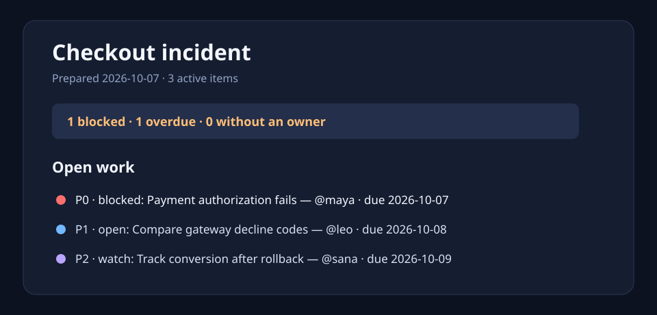

# Triage Tape

**A calm, decision-ready incident handoff from the notes you already write.**

Triage Tape is a tiny, dependency-free Python CLI for converting a line-oriented incident log into a readable Markdown brief. It sorts the work, calls out blockers and overdue items, and makes missing ownership impossible to miss.



## Why it exists

During an incident, notes accumulate faster than shared context. Triage Tape keeps the input deliberately low-friction while giving the next shift a clean answer to: what is broken, what matters first, who owns it, and what needs an unblock.

## Features

- One human-editable text file; no vendor account or database
- Priority-aware ordering from P0 through P3
- Clear blocker, overdue, and unowned-work signals
- Markdown output suitable for a pull request, Slack, or incident channel
- Helpful warnings for malformed lines, without discarding good entries

## Quick start

```bash
git clone https://github.com/Chandan-14r/triage-tape.git
cd triage-tape
python -m pip install -e .
triage-tape examples/checkout-incident.txt --title "Checkout incident" -o handoff.md
```

Input uses a compact, forgiving format:

```text
[P0] blocked - Payment authorization fails @maya due:2026-10-07
[P1] open - Compare gateway decline codes @leo due:2026-10-08
[P2] done - Add a decline-rate alert @maya
```

The tool writes a Markdown handoff and reports any unreadable lines to standard error.

## Make shift changes obvious

Pass the previous shift's notes with `--since` to add a concise comparison section to the handoff. It calls out new active work and work that is no longer active, distinguishing items marked `done` from items removed from the current log.

```bash
triage-tape examples/checkout-incident.txt \
  --since examples/previous-checkout-incident.txt \
  --title "Checkout incident" -o handoff.md
```

Items are matched by their summary, so routine state, owner, priority, and due-date updates remain part of the same thread of work instead of creating noisy false changes.

## Development

```bash
python -m pip install -e . pytest
pytest
python -m triage_tape.cli examples/checkout-incident.txt --title "Checkout incident"
```

## Project layout

```text
triage_tape/       parsing, prioritization, and CLI
examples/          a realistic sample incident log
tests/             deterministic behavior tests
docs/              a visual preview of generated output
```

## Future ideas

- Optional JSON and HTML output
- Configurable state names for support and release workflows
- A `--since` mode for shift-to-shift deltas

## License

MIT. See [LICENSE](LICENSE).
